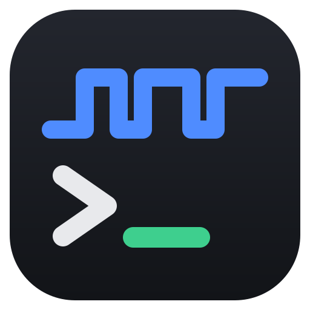

<div align="center">



# SomeTerm

**Serial, TCP and Telnet terminal with live plotting, for the lab bench.**
In the tradition of RealTerm and Tera Term, with an Arduino-style plotter built in.
Runs in Chrome or Edge with nothing to install, or as a desktop app on Windows, macOS and Linux.

[](https://github.com/r-panicker/SomeTerm/actions/workflows/release.yml)
[](https://github.com/r-panicker/SomeTerm/releases)

**[Open in the browser](https://r-panicker.github.io/SomeTerm/)** · [Download the desktop app](https://github.com/r-panicker/SomeTerm/releases/latest) · [User guide](docs/user-guide.md) · [Specs and changelog](docs/specs.md)


</div>

## Why SomeTerm

| | |
|---|---|
| **Several connections at once** | Serial ports, TCP and Telnet side by side, each with its own settings, plus a merged Monitor that interleaves them by time. |
| **Bridging and forwarding** | Join any two connections: serial to serial to sniff a link, or serial to a TCP server to put a board on the network. |
| **Plotting built in** | Print numbers and they're plotted, next to the text they came from. Cursors, statistics, XY and spectrum views, unit conversions. |
| **Profiles** | Save a board's settings once; they apply themselves when it's plugged in again. Share them as a file with a class. |
| **Display your way** | ASCII, hex, decimal, binary, decoded integers and floats, an xterm screen for menus and editors, timestamps, colour rules. |
| **Automation** | Auto-replies answer prompts, quick-send buttons hold your common commands, send lines repeat with timing and checksums. |
| **Search and logging** | Regex find with a filter mode; log sent and received data to disk with triggers and rotation, or record a session and replay it later with no hardware. |
| **Configurable, not cluttered** | RealTerm-depth settings in tabs under the terminal, one click away and folded when you don't need them. Keyboard shortcuts, dark and light themes, works on a phone. |
| **Keeps up** | Comfortable at 921600 baud and beyond, with byte counts, rates and line signals shown when they mean something. |

## Features

### Connect
| | |
|---|---|
| Port settings | Any baud rate, 5–8 data bits, none/even/odd/mark/space parity, 1/1.5/2 stop bits, RTS/CTS and XON/XOFF flow control |
| Line control | DTR and RTS toggles, timed break, live CTS/DSR/DCD/RI indicators |
| Auto-reconnect | Unplug or reset the board and the connection picks it up again with the same settings, even under a new port name |
| Several connections | Serial ports and network connections side by side, a merged **Monitor** of all traffic, and forwarding or bridging between them |
| Profiles | Save a connection's settings, including a TCP/Telnet host and port; matched by USB ID (and serial number on desktop) and applied automatically |
| Network | Raw TCP and Telnet, as client or server (desktop app) |
| Bridging | Forward one connection's data out of another, or bridge both ways: serial ⇄ serial, serial ⇄ TCP/Telnet, TCP ⇄ TCP. Serial bridging works in the browser too |

### See the data
| | |
|---|---|
| Views | ASCII, Hex, Dec (each byte 0–255), Bin, and **Int/Float**: decode the stream as int8–int32 or float32/64, either byte order, with alignment |
| Terminal | Timestamps, ANSI colours, RealTerm-style `[CR]` `[LF]` control-character display, sent data inline |
| Find | Live search with regex, case matching and a filter mode |
| Colour rules | Keep errors red and OK/PASS green across every connection; one click turns a search into a rule |
| Terminal mode | Click in the terminal and type: keys go straight to the device, like GTKTerm or TeraTerm, with optional coloured local echo |
| xterm | Terminal emulator view (VT100/xterm) for boot menus, `top` and editors |
| Quick sends | Buttons for the commands you send most, Alt+1…9 |
| File upload | Raw, XMODEM, XMODEM-1K or YMODEM, for bootloaders and U-Boot |

### Plot
| | |
|---|---|
| Arduino-style | Any line of numbers is plotted: `1,2,3`, `1 2 3`, `temp:23.1,hum:41`, `temp=23.1 hum=41` |
| Analyse | Zoom, pause, A/B cursors with Δt and frequency, min/max/mean/σ over the visible range |
| Modes | Against time, **XY** (Lissajous figures, I–V curves), and **spectrum** (FFT in dB with peak readout) |
| Conversions | Per-series expression and unit, e.g. `x*3.3/4095` in V; CSV export with units |


### Send
| | |
|---|---|
| Input | Text with `\r \n \t \xNN` escapes, or raw hex; history with ↑/↓ |
| Send lines | RealTerm-style lines with **Send ASCII** and **Send Numbers** (`65 0x41 $41 41h 0b1000001 'A'`) |
| Framing | Line ending plus Sum8, XOR8, CRC-8, CRC-16 (Modbus, CCITT) or CRC-32 |
| Timing | Repeat N times or forever, inter-byte and inter-line delays, choose a file then send it with progress |
| Half duplex | Wait for each character's echo, or hold RTS while transmitting for RS-485 adapters |
| Auto-replies | Answer prompts automatically: text or regex patterns with `$1` substitution and a loop guard |

### Logging and replay
| | |
|---|---|
| Logging | Timestamped text, raw bytes or timestamped hex; received, sent or both; straight to disk or in memory |
| Triggers and limits | Start after N bytes or on a piece of text, stop after a size or time |
| Rotation | Split into numbered files every N MB or N minutes for long unattended logs |
| Record and replay | Save a session as `.strec` and play it back later, at speed or instantly, with seeking. Handy for marking and demos with no hardware |

### Settings in tabs, RealTerm style
Every setting sits in a tab under the terminal: Display, Port, Send, Logging, Plot, Automation, Profiles and App. Each has one home, always one click away; click the showing tab to fold the panel for more room. The status bar keeps the essentials in view (profile, `115200 8N1`, any bridge) and opens the Port tab when clicked. On/off switches carry a light, so they never look like buttons. Light, dark or system theme, and it works on a phone.


## Get it

### Desktop app
Download the installer for your OS from [Releases](https://github.com/r-panicker/SomeTerm/releases):

| OS | File |
|---|---|
| Windows | `SomeTerm-<version>-win-x64.exe` |
| macOS | `SomeTerm-<version>-mac-arm64.dmg` (Apple Silicon) or `SomeTerm-<version>-mac-x64.dmg` (Intel) |
| Linux | `SomeTerm-<version>-linux-x86_64.AppImage` |

The builds are not code-signed yet, so the first launch needs one extra step:

| OS | First launch |
|---|---|
| Windows | On the SmartScreen warning, click **More info → Run anyway**. If there is no **Run anyway**, right-click the downloaded `.exe` → **Properties**, tick **Unblock** at the bottom of the General tab, click OK, then run it again. |
| macOS | Open the `.dmg` and drag SomeTerm to Applications. Open it once and dismiss the warning, then go to **System Settings → Privacy & Security** and click **Open Anyway**. Alternatively, run `xattr -dr com.apple.quarantine /Applications/SomeTerm.app` in Terminal. |
| Linux | `chmod +x SomeTerm-*.AppImage`, then run it. |

### Browser
Nothing to install. Open this link in Chrome or Edge:

**https://r-panicker.github.io/SomeTerm/**

It always runs the latest code on `main`. To run a copy yourself, unzip `SomeTerm-web-<version>.zip` from a release, start a local server in that folder, and open http://localhost:8000:

```bash
python -m http.server 8000
```

Web Serial needs HTTPS or `localhost`, so opening `index.html` straight from disk won't work.

### Browser or desktop?
Both run the same app. The desktop version talks to the OS serial driver directly, so it can do a little more:

| | Browser (Web Serial) | Desktop |
|---|---|---|
| Install | none | installer |
| 5/6 data bits, XON/XOFF | no | yes |
| Mark/space parity, 1.5 stop bits | no | Windows |
| Ports the OS doesn't list (socat, ptys) | no | yes |
| RI input | yes | no |
| TCP and Telnet | no | yes |

## Build from source

Needs Node 22 and pnpm.

```bash
pnpm install
```

```bash
pnpm dev            # browser, open the printed URL in Chrome or Edge
```

```bash
pnpm dev:electron   # desktop app
```

```bash
pnpm test           # unit tests, no hardware needed
```

`pnpm dist:electron` builds an installer for the OS you're on. Pushing a `v*` tag, or running the **Build and release** workflow with a tag filled in, builds all of them on GitHub Actions and publishes a release.

## Project layout

```
packages/
  core/                 transport interface, parsing, plotting maths, capture, send logic (pure TypeScript)
  transport-webserial/  Web Serial driver
  transport-node/       Node serialport driver, TCP/Telnet transport and Electron IPC bridge
apps/
  web/                  Svelte 5 + Vite user interface
  electron/             desktop shell
```

All I/O, serial and network alike, goes through one `SerialTransport` interface, so the core never knows which driver is underneath. A loopback and a replay transport make every feature testable without hardware.

## Status

Usable and actively developed. Serial parity with RealTerm is close: see the [parity checklist](docs/specs.md#realterm-parity-checklist) for what's done. Not planned for now: protocol decoders (Modbus, SLIP, COBS), I2C and other non-serial RealTerm features, and mobile.

## Credits

Created by **Rajesh Panicker**.

Inspired by [RealTerm](https://realterm.sourceforge.io/), [Tera Term](https://teratermproject.github.io/), GTKTerm and the Arduino Serial Plotter. SomeTerm is an independent implementation written from scratch; it is not affiliated with those projects and shares no code with them.

The xterm view uses [xterm.js](https://xtermjs.org/), and plotting uses [uPlot](https://github.com/leeoniya/uPlot).
