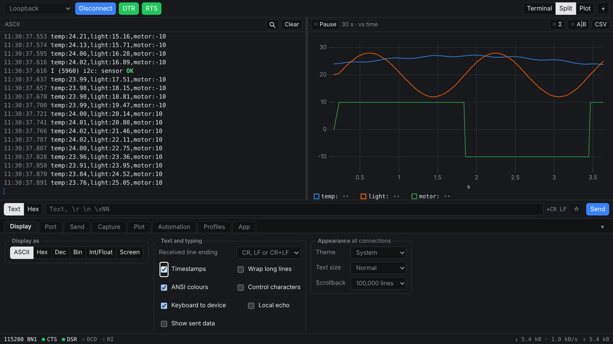
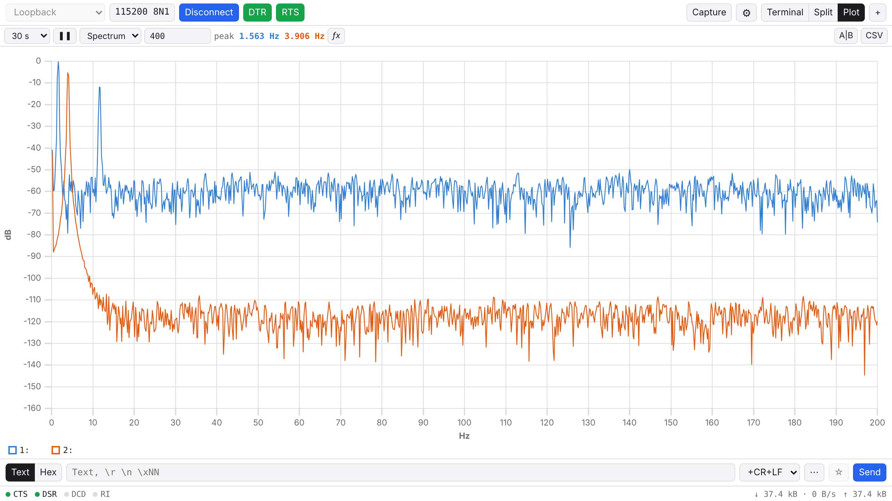
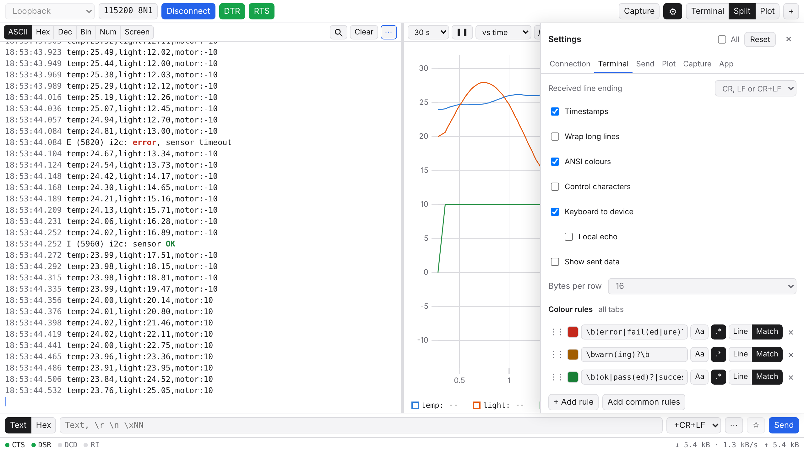

<div align="center">

# SuperSerial

**A modern serial terminal for the lab bench.**
RealTerm's serial features, Arduino-style live plotting, and a UI you don't have to fight.
Runs in Chrome or Edge with nothing to install, or as a desktop app on Windows, macOS and Linux.

[](https://github.com/r-panicker/SuperSerial/actions/workflows/release.yml)
[](https://github.com/r-panicker/SuperSerial/releases)


[Download](https://github.com/r-panicker/SuperSerial/releases) · [User guide](docs/user-guide.md) · [Specs and changelog](docs/specs.md)



</div>

## Why SuperSerial

Serial terminals tend to fall into two camps: powerful but dense (RealTerm's wall of tabs), or friendly but shallow (a plotter that only plots). SuperSerial aims for both.

- **One window, one stream.** The terminal and the plot are fed by the same data. Click a point on the plot to jump to the line that produced it.
- **Fast.** Parsing runs in a Web Worker, and the terminal and plot are canvas-drawn. It is designed for sustained 921600 baud and up.
- **Honest about the link.** Line signals, byte and error counters, rates, timestamps and raw bytes are shown when they mean something. Settings a port can't do are greyed out with the reason, never silently ignored.
- **Built for teaching labs.** Sensible defaults, dark and light themes, keyboard shortcuts, and profiles that apply themselves when a known board is plugged in.

## Features

### Connect
| | |
|---|---|
| Port settings | Any baud rate, 5–8 data bits, none/even/odd/mark/space parity, 1/1.5/2 stop bits, RTS/CTS and XON/XOFF flow control |
| Line control | DTR and RTS toggles, timed break, live CTS/DSR/DCD/RI indicators |
| Auto-reconnect | Unplug or reset the board and the tab picks it up again with the same settings, even under a new port name |
| Several ports | One tab per port, a merged **Monitor** of all traffic, and forwarding between ports to sit in the middle of a link |
| Profiles | Save settings per device; matched by USB ID (and serial number on desktop) and applied automatically |

### See the data
| | |
|---|---|
| Views | ASCII, Hex, Dec, Bin, and **Num**: decode the stream as int8–int32 or float32/64, either byte order, with alignment |
| Terminal | Timestamps, ANSI colours, RealTerm-style `[CR]` `[LF]` control-character display, sent data inline |
| Find | Live search with regex, case matching and a filter mode |
| Colour rules | Keep errors red and OK/PASS green across every tab; one click turns a search into a rule |
| Terminal mode | Click in the terminal and type: keys go straight to the device, like GTKTerm or TeraTerm, with optional coloured local echo |

### Plot
| | |
|---|---|
| Arduino-style | Any line of numbers is plotted: `1,2,3`, `1 2 3`, `temp:23.1,hum:41`, `temp=23.1 hum=41` |
| Analyse | Zoom, pause, A/B cursors with Δt and frequency, min/max/mean/σ over the visible range |
| Modes | Against time, **XY** (Lissajous figures, I–V curves), and **spectrum** (FFT in dB with peak readout) |
| Conversions | Per-series expression and unit, e.g. `x*3.3/4095` in V; CSV export with units |



### Send
| | |
|---|---|
| Input | Text with `\r \n \t \xNN` escapes, or raw hex; history with ↑/↓ |
| Framing | Line ending plus Sum8, XOR8, CRC-8, CRC-16 (Modbus, CCITT) or CRC-32 |
| Timing | Repeat N times or forever, inter-byte and inter-line delays, send a file with progress |
| Half duplex | Wait for each character's echo, or hold RTS while transmitting for RS-485 adapters |
| Auto-replies | Answer prompts automatically: text or regex patterns with `$1` substitution and a loop guard |

### Capture and replay
| | |
|---|---|
| Capture | Timestamped text, raw bytes or timestamped hex; RX, TX or both; straight to disk or in memory |
| Triggers and limits | Start after N bytes or on a piece of text, stop after a size or time |
| Rotation | Split into numbered files every N MB or N minutes for long unattended logs |
| Record and replay | Save a session as `.ssrec` and play it back later, at speed or instantly, with seeking. Handy for marking and demos with no hardware |

### Settings, your way
Every setting is next to the thing it affects, and also gathered in one tabbed **Settings** panel (⚙ or Ctrl+,) for when you'd rather see everything at once.



## Get it

### Desktop app
Download the installer for your OS from [Releases](https://github.com/r-panicker/SuperSerial/releases):

| OS | File |
|---|---|
| Windows | `SuperSerial-<version>-win-x64.exe` |
| macOS | `SuperSerial-<version>-mac-arm64.dmg` (Apple Silicon) or `SuperSerial-<version>-mac-x64.dmg` (Intel) |
| Linux | `SuperSerial-<version>-linux-x86_64.AppImage` |

The builds are not code-signed yet, so the first launch needs one extra step:

| OS | First launch |
|---|---|
| Windows | On the SmartScreen warning, click **More info → Run anyway**. If there is no **Run anyway**, right-click the downloaded `.exe` → **Properties**, tick **Unblock** at the bottom of the General tab, click OK, then run it again. |
| macOS | Open the `.dmg` and drag SuperSerial to Applications. Open it once and dismiss the warning, then go to **System Settings → Privacy & Security** and click **Open Anyway**. Alternatively, run `xattr -dr com.apple.quarantine /Applications/SuperSerial.app` in Terminal. |
| Linux | `chmod +x SuperSerial-*.AppImage`, then run it. |

### Browser
Nothing to install. Open this link in Chrome or Edge:

**https://raw.githack.com/r-panicker/SuperSerial/web/index.html**

It always serves the latest release. To run a copy yourself, unzip `SuperSerial-web-<version>.zip` from a release, start a local server in that folder, and open http://localhost:8000:

```bash
python -m http.server 8000
```

Web Serial needs HTTPS or `localhost`, so opening `index.html` straight from disk won't work.

### Browser or desktop?
Both run the same app. The desktop version talks to the OS serial driver directly, so it can do a little more:

| | Browser (Web Serial) | Desktop |
|---|---|---|
| Install | none | installer |
| 5/6 data bits, XON/XOFF | no | yes |
| Mark/space parity, 1.5 stop bits | no | Windows |
| Ports the OS doesn't list (socat, ptys) | no | yes |
| RI input | yes | no |

## Build from source

Needs Node 22 and pnpm.

```bash
pnpm install
```

```bash
pnpm dev            # browser, open the printed URL in Chrome or Edge
```

```bash
pnpm dev:electron   # desktop app
```

```bash
pnpm test           # unit tests, no hardware needed
```

`pnpm dist:electron` builds an installer for the OS you're on. Pushing a `v*` tag, or running the **Build and release** workflow with a tag filled in, builds all of them on GitHub Actions and publishes a release.

## Project layout

```
packages/
  core/                 transport interface, parsing, plotting maths, capture, send logic (pure TypeScript)
  transport-webserial/  Web Serial driver
  transport-node/       Node serialport driver and Electron IPC bridge
apps/
  web/                  Svelte 5 + Vite user interface
  electron/             desktop shell
```

All serial I/O goes through one `SerialTransport` interface, so the core never knows which driver is underneath. A loopback and a replay transport make every feature testable without hardware.

## Status

Usable and actively developed. Serial parity with RealTerm is close: see the [parity checklist](docs/specs.md#realterm-parity-checklist) for what's done. Not planned for now: protocol decoders (Modbus, SLIP, COBS), I2C and other non-serial RealTerm features, and mobile.

SuperSerial is an independent implementation written from scratch. It is not affiliated with RealTerm and shares no code with it.
